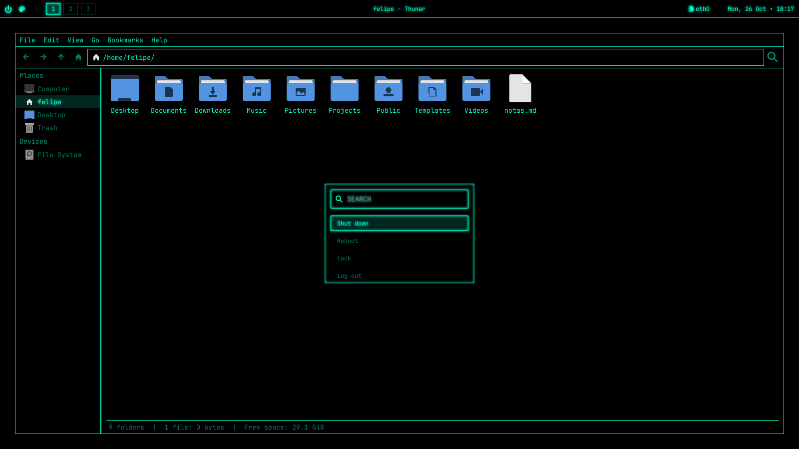

# Cyberpunk Dotfiles



## Installation

```bash
git clone <repository-url> ~/.cyberpunk-dotfiles
cd ~/.cyberpunk-dotfiles
./install.sh
```

Before copying anything, the installer backs up your current configs to `~/.dotfiles-backup-<date>`. It also renames your home folders to the system language (for example, `Pictures` becomes `Imagens` on a Portuguese system). A folder is left as is when one with the new name already exists.

## Neon color

The neon is white by default. To change it, press `SUPER + N` or click the palette icon on waybar and pick a color on the color wheel. The **Default** button goes back to white.

You can also apply a color from the terminal:

```bash
~/.config/neon/apply.sh 00ffcc
```

GTK apps that were already open (like Thunar) only change color after a restart.

## Languages

The menus, waybar and the color wheel follow the system language. The available languages are the 10 most spoken in the world:

| Language | Native name | Code |
| --- | --- | --- |
| English | English | `en_US` |
| Mandarin (simplified) | 中文（简体） | `zh_CN` |
| Hindi | हिन्दी | `hi_IN` |
| Spanish | Español | `es_ES` |
| Arabic | العربية | `ar_SA` |
| French | Français | `fr_FR` |
| Bengali | বাংলা | `bn_BD` |
| Portuguese | Português | `pt_BR` |
| Russian | Русский | `ru_RU` |
| Indonesian | Bahasa Indonesia | `id_ID` |

Other variants of a language use its translation (for example, `es_MX` uses `es_ES` and `pt_PT` uses `pt_BR`). Languages without a translation fall back to English.

## License

[MIT](LICENSE)