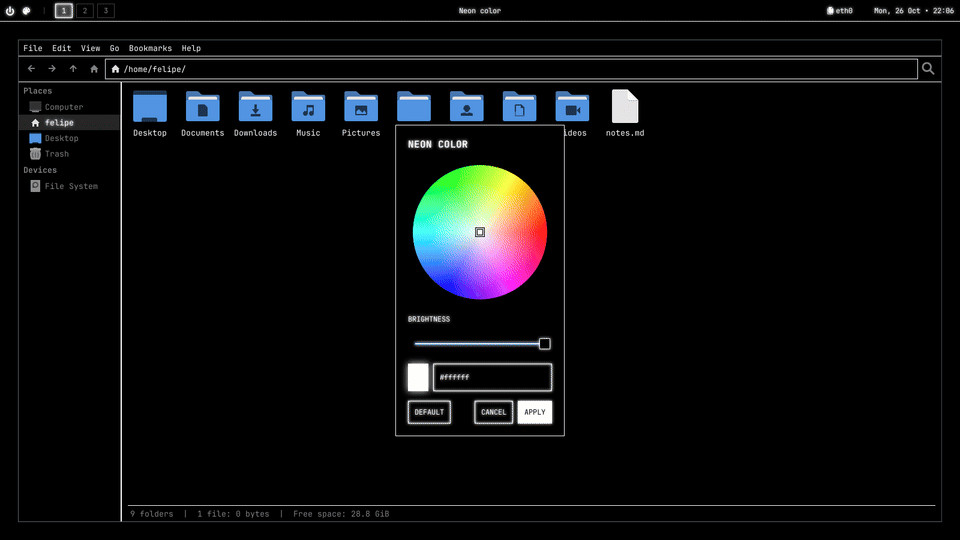

# Cyberpunk Dotfiles




## Requirements

- Arch Linux
- Hyprland 0.56.2 or newer (the config uses Hyprland's Lua format)

## Installation

```bash
git clone <repository-url> ~/.cyberpunk-dotfiles
cd ~/.cyberpunk-dotfiles
./install.sh
```

Before copying anything, the installer backs up your current configs to `~/.dotfiles-backup-<date>`. It also renames your home folders to the system language (for example, `Pictures` becomes `Imagens` on a Portuguese system). A folder is left as is when one with the new name already exists.

It also installs the **SDDM** login screen theme and enables SDDM, replacing any other display manager (GDM, LightDM…). The change takes effect on the next boot.

## Neon color

The neon is white by default. To change it, press `SUPER + N` or click the palette icon on waybar and pick a color on the color wheel. The **Default** button goes back to white.

The login screen, the terminal and Neovim follow the chosen color too.

You can also apply a color from the terminal:

```bash
~/.config/neon/apply.sh 00ffcc
```

GTK apps that were already open (like Thunar) only change color after a restart. Open terminals and Neovim windows change right away.

## Terminal and Neovim

The [foot](https://codeberg.org/dnkl/foot) terminal uses the neon for the text, the cursor and the selection. The other terminal colors are neon versions of the usual ones, so errors, diffs and file types stay easy to tell apart.

The `cyberpunk` Neovim colorscheme is monochrome, like the rest of the theme: code is told apart by brightness and style, and color is only used for errors, warnings and diffs. The installer only adds the colorscheme, so your Neovim config is kept. If you don't have one, it creates a minimal config that uses the theme. To use it in your own config:

```lua
vim.cmd.colorscheme("cyberpunk")
```

## Weather

Waybar shows the weather next to the clock, from [Open-Meteo](https://open-meteo.com) (free, no account or API key). It works out of the box: the location comes from your IP, looked up on [ipinfo.io](https://ipinfo.io), and the units follow your country (°F in the US, °C elsewhere).

To set the city yourself, for example when you use a VPN, **right click the weather** and type the city. Choose **Automatic** in the same menu to go back to the location of your IP. You can also set it in `~/.config/waybar/weather.conf`:

```bash
city="São Paulo"
units="metric"    # or "imperial" for °F and mph; empty follows your country
```

Hover over it for details, and click it to refresh the weather and look up the location again. It updates every 15 minutes, and shows the last weather it got while offline. Your IP is sent to ipinfo.io to find the location (unless you set a city), and the coordinates to Open-Meteo to get the forecast.

## Keybindings

`SUPER` is the Windows key.

| Keys | Action |
| --- | --- |
| `SUPER + Return` | Open the terminal (foot) |
| `SUPER + D` | Open the app launcher |
| `SUPER + E` | Open the file manager (Thunar) |
| `SUPER + N` | Pick the neon color |
| `SUPER + Q` | Close the window (with no window open: power menu) |
| `SUPER + L` | Lock the screen |
| `SUPER + V` | Toggle floating |
| `SUPER + P` | Toggle pseudo-tiling |
| `SUPER + J` | Toggle the split direction |
| `SUPER + arrows` | Move focus |
| `SUPER + 1…0` | Go to workspace 1–10 |
| `SUPER + SHIFT + 1…0` | Move the window to workspace 1–10 |
| `SUPER + TAB` | Show or hide the scratchpad |
| `SUPER + SHIFT + TAB` | Move the window to the scratchpad |
| `SUPER + mouse wheel` | Switch workspace |
| `SUPER + left drag` | Move the window |
| `SUPER + right drag` | Resize the window |
| `SUPER + PRINT` | Screenshot of the whole screen |
| `SUPER + SHIFT + PRINT` | Screenshot of an area |
| 3-finger horizontal swipe | Switch workspace |

Screenshots are saved to your pictures folder. The media, volume and brightness keys work as usual.

## Languages

The menus, waybar, the color wheel and the login screen follow the system language. The available languages are the 10 most spoken in the world:

| Language | Native name | Code |
| --- | --- | --- |
| English | English | `en_US` |
| Mandarin (simplified) | 中文（简体） | `zh_CN` |
| Hindi | हिन्दी | `hi_IN` |
| Spanish | Español | `es_ES` |
| Arabic | العربية | `ar_SA` |
| French | Français | `fr_FR` |
| Bengali | বাংলা | `bn_BD` |
| Portuguese | Português | `pt_BR` |
| Russian | Русский | `ru_RU` |
| Indonesian | Bahasa Indonesia | `id_ID` |

Other variants of a language use its translation (for example, `es_MX` uses `es_ES` and `pt_PT` uses `pt_BR`). Languages without a translation fall back to English.

## License

[MIT](LICENSE)
